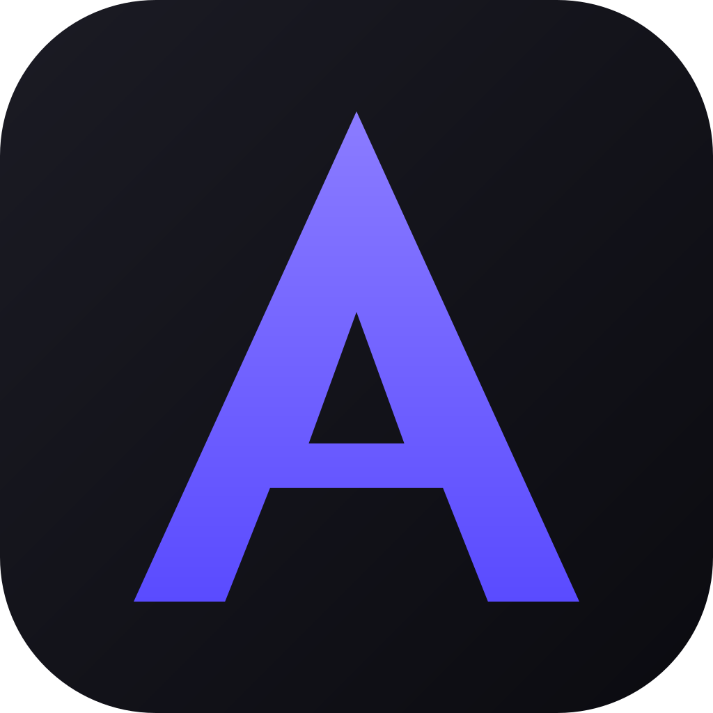

# AxxistSteam

**Your Steam library, working for you.**
Idle games, farm trading cards, unlock achievements, and collect free games - all from one beautiful desktop app.

  
  &nbsp;
  

  <a href="../../releases/latest">Latest Release</a> •
  <a href="../../releases">All Releases</a> •
  <a href="docs/INSTALLATION.md">Installation Guide</a> •
  <a href="docs/UPDATES.md">Update Guide</a> •
  <a href="https://discord.gg/k3fara4U64">Discord</a>

---

> **Note:** This repository contains **no source code**. It is the official public distribution
> point for AxxistSteam: installers are published as [GitHub Releases](../../releases), and the
> update manifests (`latest.json`, `update.json`, `history.json`) that power the in-app updater
> live here. AxxistSteam is proprietary software - see [LICENSE](LICENSE).

---

## ✨ Features

<table>
  <tr>
    <td width="50%">
      <h3>⏱️ Playtime Booster</h3>
      
Boost the playtime of any game in your library with one click. Presets, queue management and per-game rules included.

    </td>
    <td width="50%">
      <h3>🃏 Card Farming</h3>
      
Automatically find games with remaining trading card drops and farm them in the background - scan your library, queue, done.

    </td>
  </tr>
  <tr>
    <td width="50%">
      <h3>🏆 Achievement Unlocker</h3>
      
Scan your library for unlockable achievements and unlock them according to your own rules - delay, order, and quantity limits.

    </td>
    <td width="50%">
      <h3>🎁 Free Games & Packages</h3>
      
Never miss a 100%-off promo or free weekend again. AxxistSteam discovers them and can collect them automatically for every signed-in account.

    </td>
  </tr>
  <tr>
    <td width="50%">
      <h3>👥 Multi-Account Dashboard</h3>
      
Manage several Steam accounts side by side - profile cards with level, playtime, VAC status, and a per-account activity log.

    </td>
    <td width="50%">
      <h3>🔄 Built-in Updater</h3>
      
Update notifications right in the app, a full release history in Settings, and one-click updates - no manual downloads needed.

    </td>
  </tr>
</table>

---

## ⬇ Download

Get the latest installer from the [**Latest Release**](../../releases/latest) page:

| Platform | File | Notes |
|----------|------|-------|
| **Windows** | `AxxistSteam_*_x64-setup.exe` | Windows 10/11 (64-bit), per-machine installer |
| **Linux** | `axxiststeam_*_amd64.deb` | Debian/Ubuntu/Kali - `sudo dpkg -i` |
| **Linux** | `*_amd64.AppImage` | Portable, supports in-app self-updates |

Detailed instructions: [**docs/INSTALLATION.md**](docs/INSTALLATION.md)

---

## 🔄 Updates

AxxistSteam checks for updates automatically in the background and lets you know in the app -
never silently installs anything.

- **Notification badge** in the title bar when an update is available, with a **quick-update button**
- **Settings → Updates**: installed version, manual check, changelog preview and the complete update history
- **What's-new dialog** after every update shows exactly what changed
- Windows & AppImage builds update **in-app with one click**; `.deb` installs get a download link (system packages can't replace themselves)

More details: [**docs/UPDATES.md**](docs/UPDATES.md)

---

## 🚀 Latest Release

<!-- LATEST-RELEASE:START -->
**[v1.0.0 Alpha](../../releases/latest)** - first public alpha release of AxxistSteam, published
on 2026-08-15.
<!-- LATEST-RELEASE:END -->

The complete history of every published version lives in the [release history](#-release-history)
below and, machine-readable, in [`history.json`](history.json).

---

## 🗂 Release History

<!-- RELEASE-HISTORY:START -->
| Version | Date | Notes |
|---------|------|-------|
| [v1.0.3](../../releases/tag/v1.0.3) | 2026-08-23 | See release notes |
| [v1.0.1 Alpha](../../releases/tag/v1.0.1) | 2026-08-19 | First public Release |
| [v1.0.0 Alpha](../../releases/tag/v1.0.0) | 2026-08-15 | First Alpha Update |
<!-- RELEASE-HISTORY:END -->

Older versions: see the [full releases page](../../releases).

---

## 🗺 Roadmap

The next major direction is **AxxistSteam V2.0.0 — Steam Market Update**: bringing the market side
of your Steam account into the same dashboard your library already lives in. Early, deliberately
high-level themes (no dates, no promises - the details are still being designed):

- 💹 **Market automation** - letting routine market actions run by your rules instead of by hand.
  > ⚠️ Anything that buys or sells on the Steam Market uses your account at *your* risk and may
  > conflict with Steam's rules (rate limits, market restrictions, or worse). It would never be an
  > official Steam feature, and it is not available today.
- 🔔 **Price alerts** - get told when items you care about move.
- 📚 **Duplicate-item visibility** - see stacked duplicates across your inventory at a glance.
- 📈 **Profit/loss statistics** - what your market activity actually gained or cost you.
- 🕰 **Sales history** - your market transactions, browsable in one place.
- 🔍 **Steam Market analysis** - trends and pricing context for the items you hold.
- 💼 **Portfolio-style analysis** - your inventory's market value broken down like a portfolio.

Already shipped: multi-account dashboard with per-account analytics, playtime booster with presets
and persistent analytics, card farming with queue/blacklist, achievement unlocker with ordering and
schedules, free games & free packages auto-collect, and a signed in-app updater.

Vote on features or suggest your own on [Discord](https://discord.gg/k3fara4U64) or via
[feature request](../../issues/new?template=feature_request.yml).

---

## 🔒 Privacy, Security & Legal

- Your Steam credentials and tokens stay in your OS keychain and are only ever sent to Steam
  itself; the app has no telemetry at all. The full, concrete data-flow list (what is stored, what
  is sent where, and when) is in the [Privacy Policy](docs/PRIVACY.md).
- Updater artifacts are minisign-signed and verified in-app before installing; installers are
  distributed exclusively through this repository's Releases. Details and vulnerability reporting:
  [Security Policy](SECURITY.md).
- The source code is private, but developers can request a **manual code checkup** of the current
  version via [Discord](https://discord.gg/k3fara4U64) - see the Security Policy for how that works.
- [Terms of Use](docs/TERMS.md) · [Privacy Policy](docs/PRIVACY.md) · [Security Policy](SECURITY.md)
  · [License](LICENSE)

---

## 🤝 Contributing

This repository is the public distribution point - the application source code is private. You can
still contribute: bug reports, feature requests, documentation and translations are all welcome.
See [CONTRIBUTING.md](CONTRIBUTING.md) and our [Code of Conduct](CODE_OF_CONDUCT.md).

---

  AxxistSteam is not affiliated with Valve Corporation or Steam. Steam and the Steam logo are trademarks of Valve Corporation.
   
  © 2026 AxxistSteam. All rights reserved.

